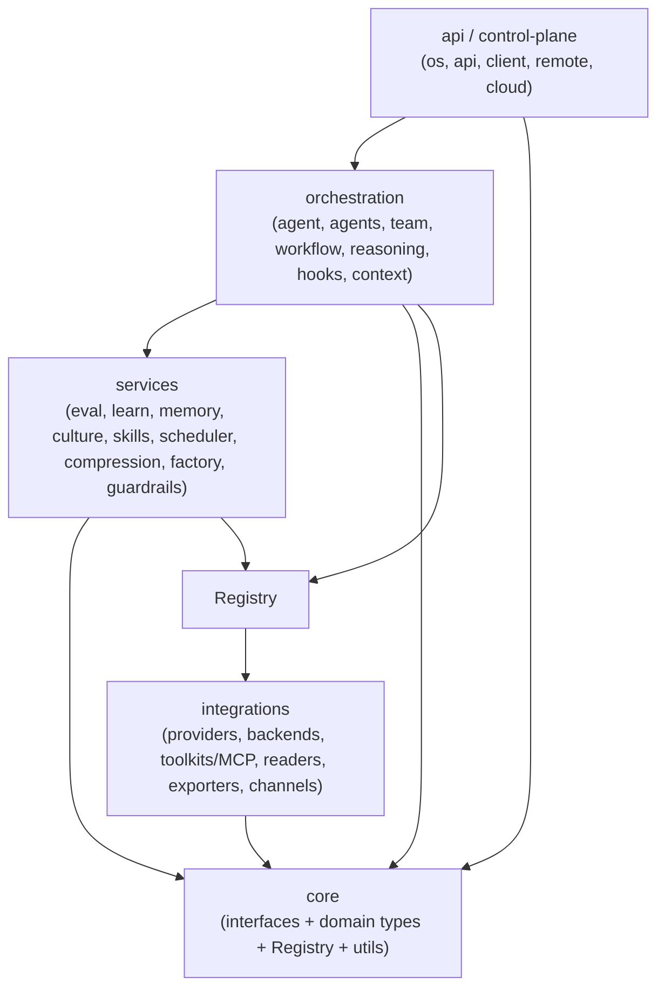

# ADR 0001: Layered Architecture and Dependency Rules

- **Status:** Proposed
- **Date:** 2026-07-22
- **Backlog:** EGPT-1.1 ([aicoe-tracker#42](https://github.com/Saturam-Inc/aicoe-tracker/issues/42))
- **Epic:** 1 – Modular architecture
- **Deciders:** Architecture owners (framework)

## Context

The framework package (`egpt`) mixes external-system code (concrete model providers, DB/vector backends, tools, knowledge readers, tracing exporters) into the same packages as domain interfaces. Core orchestration imports concrete integration modules directly. That coupling blocks reuse and independent evolution of adapters.

Before moving code (EGPT-1.4 through 1.8) or enforcing boundaries in CI (EGPT-1.11), we need an agreed target architecture and a one-directional dependency rule.

### Current inventory (top-level under `libs/agno/egpt/`)

Packages: `agent/`, `agents/`, `api/`, `approval/`, `client/`, `cloud/`, `compression/`, `context/`, `culture/`, `db/`, `eval/`, `factory/`, `guardrails/`, `hooks/`, `integrations/`, `knowledge/`, `learn/`, `memory/`, `models/`, `os/`, `reasoning/`, `registry/`, `remote/`, `run/`, `scheduler/`, `session/`, `skills/`, `team/`, `tools/`, `tracing/`, `utils/`, `vectordb/`, `workflow/`.

Loose modules: `brand.py`, `debug.py`, `exceptions.py`, `filters.py`, `media.py`, `metrics.py`.

Relevant existing seams:

- `integrations/` exists but is nearly empty (currently `discord/` only). It is repurposed as **the** integrations layer.
- `registry/registry.py` `Registry` already resolves models, tools, dbs, vector dbs, knowledge, and schemas by id/name. Keep and generalize later (EGPT-1.9); do not replace.

## Decision

Adopt a five-layer architecture with dependencies pointing **inward** toward stable core interfaces. Integrations are a separate, self-contained, reusable layer. Runtime resolution of concrete adapters goes through `Registry` (and, later, the DI container from EGPT-1.2).

### Layers and responsibilities

| Layer | Responsibility |
|-------|----------------|
| **core** | Stable interfaces, domain types, shared utilities, and the `Registry` resolution seam. No concrete external-system adapters. |
| **orchestration** | Agent / team / workflow runtime: planning, hooks, reasoning, and run context wiring. Depends on core interfaces only. |
| **services** | Supporting capabilities used by orchestration (eval, learn, memory, culture, skills, scheduler, compression, factory, guardrails). Depends on core interfaces only. |
| **integrations** | Concrete external-system adapters: model providers, DB/vector backends, toolkits/MCP, knowledge readers/embedders, tracing exporters, and channel integrations. Depends on **core only**. Independently reusable and testable. |
| **api / control-plane** | HTTP/OS surfaces and remote clients (`os/`, `api/`, `client/`, `remote/`, `cloud/`). Depends on orchestration (and transitively services/core). Must not import concrete integrations directly. |

### Layer diagram



### Design decisions

| # | Decision | Rationale | Alternatives considered |
|---|----------|-----------|-------------------------|
| 1 | Integrations are a separate, reusable layer | Isolate external systems for reuse and testability | Keep them mixed into core (rejected: current coupling) |
| 2 | Dependencies point inward to core interfaces | Stable core, swappable edges, no cycles | Bidirectional deps (rejected: cycles, fragility) |
| 3 | Repurpose the existing `integrations/` package | Already exists (near-empty); avoids a redundant top-level | New top-level directory (rejected: redundant) |
| 4 | Keep the existing `Registry` as the resolution seam | Already resolves by id/name; generalize rather than replace | Build a new registry (rejected: duplication) |
| 5 | Split interface from implementation in `models/`, `db/`, `vectordb/`, `knowledge/`, `tools/` | Concrete mechanism that decouples core from integrations | Move whole packages wholesale (rejected: drags interfaces out of core) |

## Layer → module mapping

Logical target mapping for every current top-level module. Physical moves are implemented in EGPT-1.4 through 1.8; this table is the contract those tickets execute against.

Packages marked **split** keep interfaces/types in **core** and move concrete implementations to **integrations**.

### core (interfaces + domain)

| Module | Notes |
|--------|-------|
| `models/base.py`, `models/message.py`, `models/response.py`, `models/metrics.py`, `models/defaults.py`, `models/fallback.py` | Model interface and domain types stay in core |
| `db/base.py`, `db/schemas/`, `db/migrations/`, `db/table_names.py`, `db/filter_converter.py`, `db/utils.py` | DB interface + shared schema/migration helpers |
| `vectordb/base.py`, `vectordb/distance.py`, `vectordb/score.py`, `vectordb/search.py` | Vector DB interface + shared search helpers |
| `knowledge/protocol.py`, `knowledge/types.py`, `knowledge/knowledge.py`, `knowledge/content.py`, `knowledge/document/`, `knowledge/chunking/`, `knowledge/utils.py`, `knowledge/filesystem.py` | Knowledge interfaces and domain types (not readers/embedders) |
| `tools/function.py`, `tools/toolkit.py`, `tools/decorator.py` | Tool/function interfaces and registration decorator |
| `run/` | Run context and run-lifecycle domain types |
| `session/` | Session domain types |
| `approval/` | Approval domain types and `@approval` decorator |
| `registry/` | Resolution seam (`Registry`); generalized in EGPT-1.9 |
| `utils/` | Shared helpers; importable by any layer that may depend on core |
| `exceptions.py`, `filters.py`, `media.py`, `metrics.py`, `brand.py`, `debug.py` | Framework-wide domain / helper modules |

### orchestration

| Module | Notes |
|--------|-------|
| `agent/` | Primary agent runtime |
| `agents/` | Built-in / specialized agent definitions that are orchestration, not external adapters |
| `team/` | Multi-agent team runtime |
| `workflow/` | Workflow runtime |
| `reasoning/` | Reasoning loops / strategies |
| `hooks/` | Run hooks |
| `context/` | Context builders / assemblers (orchestration wiring; external connectors under `context/` that talk to Gmail/Slack/etc. move with integrations when extracted) |

### services

| Module | Notes |
|--------|-------|
| `eval/` | Evaluation |
| `learn/` | Learning stores / managers |
| `memory/` | Memory managers / strategies |
| `culture/` | Culture / shared preferences |
| `skills/` | Skills loading / management |
| `scheduler/` | Scheduling |
| `compression/` | Context compression |
| `factory/` | Component factories (construct via Registry / DI; no concrete provider imports) |
| `guardrails/` | Guardrail policies |

### integrations (separate, reusable)

| Module | Notes |
|--------|-------|
| `integrations/` | Existing package; destination for channel and other external adapters (already has `discord/`) |
| `models/<providers>/` | All concrete providers (`openai/`, `anthropic/`, `ollama/`, …) |
| `db/<backends>/` | Concrete DB backends (`postgres/`, `sqlite/`, `mongo/`, …) |
| `vectordb/<backends>/` | Concrete vector backends (`pgvector/`, `lancedb/`, `chroma/`, …) |
| `tools/<toolkits>/`, `tools/mcp/`, `tools/mcp_toolbox.py` | Concrete toolkits and MCP adapters (not `function`/`toolkit`/`decorator`) |
| `knowledge/reader/`, `knowledge/embedder/`, `knowledge/reranker/`, `knowledge/loaders/`, `knowledge/remote_content/`, `knowledge/remote_knowledge.py` | I/O and remote knowledge adapters |
| `tracing/exporter.py` (+ provider-specific exporters when added) | Tracing exporters |
| External connectors currently under `context/` (e.g. gmail, slack, gdrive) | Move into integrations when extracted |

### api / control-plane

| Module | Notes |
|--------|-------|
| `os/` | EgptOS app, routers, middleware |
| `api/` | API schemas / surfaces |
| `client/` | Client SDK |
| `remote/` | Remote agent/team clients |
| `cloud/` | Cloud deployment helpers |

### Split packages (interface vs implementation)

These packages are the central decoupling mechanism. Interfaces stay addressable from core; implementations live under the integrations layer (physically under `integrations/` or remaining as leaf packages that integrations owns for import-lint purposes—see EGPT-1.4–1.8).

| Package | Stay in core (interface / domain) | Move to integrations (implementation) |
|---------|-----------------------------------|----------------------------------------|
| `models/` | `base.py`, `message.py`, `response.py`, `metrics.py`, `defaults.py`, `fallback.py` | Every provider package (`openai/`, `anthropic/`, `google/`, …) |
| `db/` | `base.py`, `schemas/`, `migrations/`, `table_names.py`, `filter_converter.py`, `utils.py` | Every backend package (`postgres/`, `sqlite/`, `mongo/`, …) |
| `vectordb/` | `base.py`, `distance.py`, `score.py`, `search.py` | Every backend package (`pgvector/`, `lancedb/`, `chroma/`, …) |
| `knowledge/` | `protocol.py`, `types.py`, `knowledge.py`, `content.py`, `document/`, `chunking/`, `utils.py`, `filesystem.py` | `reader/`, `embedder/`, `reranker/`, `loaders/`, `remote_content/`, `remote_knowledge.py` |
| `tools/` | `function.py`, `toolkit.py`, `decorator.py` | All toolkit modules, `mcp/`, `mcp_toolbox.py`, and similar adapters |
| `tracing/` | `schemas.py`, `setup.py` (wiring against core interfaces) | `exporter.py` and concrete exporters |

### Traceability checklist (no orphans)

Every current top-level name appears exactly once in the mapping above:

`agent`, `agents`, `api`, `approval`, `brand.py`, `client`, `cloud`, `compression`, `context`, `culture`, `db`, `debug.py`, `eval`, `exceptions.py`, `factory`, `filters.py`, `guardrails`, `hooks`, `integrations`, `knowledge`, `learn`, `media.py`, `memory`, `metrics.py`, `models`, `os`, `reasoning`, `registry`, `remote`, `run`, `scheduler`, `session`, `skills`, `team`, `tools`, `tracing`, `utils`, `vectordb`, `workflow`.

## Allowed-import matrix

This matrix is the contract EGPT-1.11 will encode as import-linter contracts. Rows are importers; columns are import targets. `Y` = allowed, `N` = forbidden.

| Importer ↓ / Target → | core | orchestration | services | integrations | api |
|-----------------------|------|---------------|----------|--------------|-----|
| **core** | Y (internal) | N | N | N | N |
| **orchestration** | Y | Y (internal) | Y | N | N |
| **services** | Y | N | Y (internal) | N | N |
| **integrations** | Y | N | N | Y (internal) | N |
| **api** | Y | Y | Y | N | Y (internal) |

### Rules (normative)

1. **Inward only:** `api → orchestration → services → core`.
2. **integrations → core only.** Integrations must not import orchestration, services, or api.
3. **orchestration and services** may depend on **core interfaces only**, never on concrete integration modules (no `from egpt.models.openai …`, `from egpt.db.postgres …`, toolkit modules, readers, exporters, etc.).
4. **api / control-plane** must not import concrete integrations directly; obtain adapters via constructor injection / `Registry`.
5. **`Registry`** (core) is the runtime resolution seam. Services and orchestration resolve concrete implementations by id/name through Registry (or the future DI container), not via static imports of integration modules.
6. **Same-layer imports** are allowed.
7. **Cycles across layers are forbidden.**

### Import-linter sketch (for EGPT-1.11)

Logical contract names (exact path globs finalized when packages are physically split):

```ini
[importlinter]
root_package = egpt

[importlinter:contract:layers]
name = Layered architecture
type = layers
layers =
    egpt.os | egpt.api | egpt.client | egpt.remote | egpt.cloud
    egpt.agent | egpt.agents | egpt.team | egpt.workflow | egpt.reasoning | egpt.hooks | egpt.context
    egpt.eval | egpt.learn | egpt.memory | egpt.culture | egpt.skills | egpt.scheduler | egpt.compression | egpt.factory | egpt.guardrails
    egpt.models.base | egpt.db.base | egpt.vectordb.base | egpt.knowledge | egpt.tools.function | egpt.registry | egpt.run | egpt.session
# integrations modules must not be imported by layers above; enforced via forbidden/independence contracts

[importlinter:contract:integrations-depend-only-on-core]
name = Integrations depend only on core
type = forbidden
source_modules =
    egpt.integrations
    # plus concrete provider/backend/toolkit modules after moves
forbidden_modules =
    egpt.agent
    egpt.team
    egpt.workflow
    egpt.os
    egpt.api
```

Until physical moves land, treat the matrix as the design contract; EGPT-1.11 sanity-checks expressibility and wires CI.

## Consequences

### Positive

- Clear ownership boundaries and a reusable integrations surface.
- Swappable providers/backends without rewriting orchestration.
- A single allowed-import matrix for reviewers and for future CI enforcement.
- Existing `integrations/` and `Registry` are reused rather than reinvented.

### Negative / follow-on work

- Requires coordinated package moves (EGPT-1.4–1.8) and temporary shims/re-exports during migration.
- Import paths for concrete providers will change for application code that currently imports them from `egpt.models.<provider>` etc. (migration notes belong in those tickets).
- `context/` contains mixed orchestration wiring and external connectors; extraction must be careful to avoid pulling orchestration into integrations.

### Out of scope for this ADR

- Actually moving any code (EGPT-1.4 through 1.8).
- DI container (EGPT-1.2).
- Registry generalization (EGPT-1.9).
- CI import-linter enforcement (EGPT-1.11).

## Compliance / review gate

This ADR is approved when architecture owners confirm:

- [ ] Five layers defined with the layer diagram above
- [ ] Layer → module mapping ratified (every current top-level module covered; no orphans)
- [ ] Allowed-import matrix defined for verbatim use by EGPT-1.11
- [ ] Integrations designated a separate, self-contained, reusable layer
- [ ] Interface/implementation split documented for `models/`, `db/`, `vectordb/`, `knowledge/`, `tools/` (and `tracing/` exporters)

## References

- Tracker: [EGPT-1.1 / aicoe-tracker#42](https://github.com/Saturam-Inc/aicoe-tracker/issues/42)
- Depends on: EGPT-0.10 (green baseline)
- Follow-ons: EGPT-1.2 (DI), EGPT-1.4–1.8 (extract moves), EGPT-1.9 (registry generalization), EGPT-1.11 (import-linter CI)
