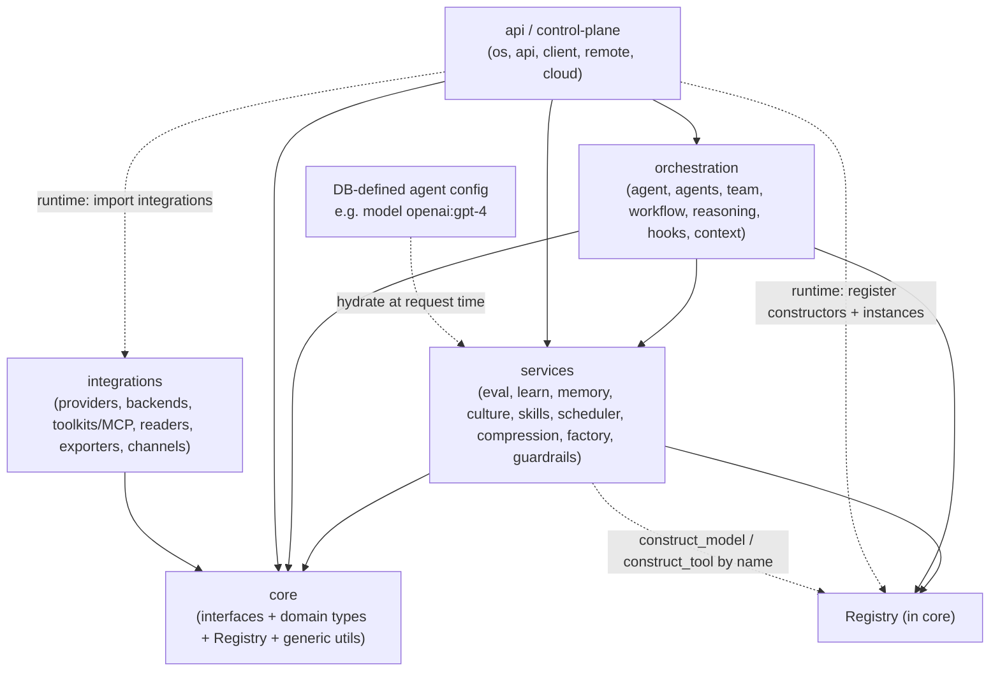

# ADR 0001: Layered Architecture and Dependency Rules

- **Status:** Proposed
- **Date:** 2026-07-22
- **Backlog:** EGPT-1.1 ([aicoe-tracker#42](https://github.com/Saturam-Inc/aicoe-tracker/issues/42))
- **Epic:** 1 – Modular architecture
- **Deciders:** Architecture owners (framework)

## Context

The framework package (`egpt`) mixes external-system code (concrete model providers, DB/vector backends, tools, knowledge readers, tracing exporters) into the same packages as domain interfaces. Core orchestration imports concrete integration modules directly. That coupling blocks reuse and independent evolution of adapters.

Before moving code (EGPT-1.4 through 1.8) or enforcing boundaries in CI (EGPT-1.11), we need an agreed target architecture and a one-directional dependency rule.

### Current inventory (top-level under `libs/agno/egpt/`)

Packages: `agent/`, `agents/`, `api/`, `approval/`, `client/`, `cloud/`, `compression/`, `context/`, `culture/`, `db/`, `eval/`, `factory/`, `guardrails/`, `hooks/`, `integrations/`, `knowledge/`, `learn/`, `memory/`, `models/`, `os/`, `reasoning/`, `registry/`, `remote/`, `run/`, `scheduler/`, `session/`, `skills/`, `team/`, `tools/`, `tracing/`, `utils/`, `vectordb/`, `workflow/`.

Loose modules: `brand.py`, `debug.py`, `exceptions.py`, `filters.py`, `media.py`, `metrics.py`.

Relevant existing seams:

- `integrations/` exists but is nearly empty (currently `discord/` only). It is repurposed as **the** integrations layer.
- `registry/registry.py` `Registry` already resolves models, tools, dbs, vector dbs, knowledge, and schemas by id/name. Keep and generalize later (EGPT-1.9); do not replace.

## Decision

Adopt a five-layer architecture with dependencies pointing **inward** toward stable core interfaces. Integrations are a separate, self-contained, reusable layer. Runtime resolution **and construction** of concrete adapters goes through `Registry` (and, later, the DI container from EGPT-1.2)—including DB-defined-agent hydration (D2).

### Layers and responsibilities

| Layer | Responsibility |
|-------|----------------|
| **core** | Stable interfaces, domain types, generic shared utilities, and the `Registry` resolution seam. No concrete external-system adapters; no static imports of integration modules. |
| **orchestration** | Agent / team / workflow runtime: planning, hooks, reasoning, and run context wiring. May depend on core and services (not integrations). |
| **services** | Supporting capabilities used by orchestration (eval, learn, memory, culture, skills, scheduler, compression, factory, guardrails). Depends on core interfaces only (including Registry construction APIs). |
| **integrations** | Concrete external-system adapters: model providers, DB/vector backends, toolkits/MCP, knowledge readers/embedders, tracing exporters, provider utils, and channel integrations. Depends on **core only**. Independently reusable and testable. |
| **api / control-plane** | HTTP/OS surfaces and remote clients (`os/`, `api/`, `client/`, `remote/`, cloud-agnostic deploy surfaces). May depend on orchestration, services, and core. Must not import concrete integrations for business logic; the **composition root** (app startup) may import integrations to register **constructors and/or instances** on `Registry`. |

### Layer diagram

Solid edges are **allowed static imports**. Dashed edges are **runtime registration only** (no static import from core → integrations).



**Registry semantics (normative):** `Registry` lives in core and only type-hints / stores objects against **core interfaces** (`Model`, `BaseDb`, `VectorDb`, `Function`, …). It must **never** statically import integration modules. A composition root (typically `egpt.os` / app startup, cookbooks, or tests) imports concrete integrations and registers them on `Registry`—both as **live instances** (`add_*` / `get_*`) and as **constructors** (see below). The dashed edges above are that runtime association—not a layer-import arrow.

#### Runtime construction seam (DB-defined agents) — normative

Decision **D2** requires agents (and related components) defined in a tenant DB and hydrated at **request time**. A DB row may name a provider/model/tool that was **not** pre-instantiated at startup (e.g. `model: "openai:gpt-4"`). An instance-only registry cannot cover that path: `services/factory` is forbidden from importing concrete integrations, yet must still build a fresh `Model` / tool / backend from config.

**Ratified seam:** a dedicated construction map colocated with `Registry`, holding **constructors / factory callables** keyed by stable provider, tool, db, vector-db, and embedder names—in addition to the optional live instances `Registry` itself holds.

**Implemented in EGPT-1.9** as `egpt/registry/discovery.py`, with module-level functions rather than methods on `Registry`. `Registry` is a per-application object while registration is process-global, so methods on the dataclass would either read a module global (two instances reporting one table) or give each instance its own (a provider registered before the app's `Registry` was built being invisible to it). DD3 keeps the two separate; `tests/unit/registry/test_registry.py::TestRegistryStaysSeparateFromTheConstructionSeam` asserts it mechanically. Shape (as shipped):

- `resolve(kind, name) -> type` / `construct(kind, name, **config)`, plus `construct_model(name, **config) -> Model` and siblings for the other kinds
- Same pattern for tools, dbs, vector dbs, embedders, and other integration kinds the factory must hydrate

**Who registers:** In-tree integrations are **declared**, in `egpt/registry/_declarations/`—one pure-data module per kind, holding `(module, attr)` strings that are imported lazily on first use. Out-of-tree integrations register through Python entry points (`egpt.models`, `egpt.dbs`, `egpt.vectordbs`, `egpt.tools`, `egpt.embedders`), and runtime code can use the `@register(kind, name)` decorator.

**Amended in EGPT-1.9 (supersedes the original wording and extraction prerequisite 2, which said the table must move out of core):** that requirement was written before EGPT-1.4–1.8 landed, when the map and the provider classes lived in the same package. The rows are *strings*, not imports: they create no static dependency edge, which is the only thing rule 2 and import-linter can observe. Moving them into `integrations/` would gain nothing and cost real correctness—something would have to import those modules for registration to happen, so either core would name an integrations module anyway (one path instead of 58) or nothing would be registered until a caller happened to import it first, an order-dependent failure landing on `services/factory`, this cell's canonical consumer.

The property that actually matters is enforced instead: **declarations must not import what they name.** `tests/unit/registry/test_discovery_laziness.py` proves in a clean interpreter that enumerating all 58 model providers and all 18 vector dbs imports no integration module and no vendor SDK. This is also why the `@register` decorator, though public and documented, is never used in-tree—decorating a class means importing it.

**Who constructs:** `services/factory` (and memory / other services) call `construct_*` with strings from DB config and receive core interface instances. No `from egpt.models.openai …` (or `from egpt.models.utils …`) in services or orchestration.

**Canonical consumer:** DB-defined-agent hydration is the defining use of this cell of the matrix. Mode A/B and other config-swappable backends (see memory note below) use the same constructor registry.

~~Known debt for EGPT-1.9: `registry.py` currently TYPE_CHECKING-imports `Agent` / `Team` (orchestration).~~ **Discharged in EGPT-1.9.** Those imports are gone: `egpt/registry/protocols.py` defines `AgentLike` / `TeamLike` (`id` plus `deep_copy`, which `workflow/step.py` calls on the result of `get_agent`/`get_team`), the catalog fields are `List[Any]` to match the four sibling catalogs, and the accessors return the protocols. Core now names no orchestration module, so the matrix is enforceable by EGPT-1.11.

Still open after EGPT-1.9, recorded so it is not mistaken for done:

- **Prerequisite 6 is half discharged.** All 18 embedders now have declaration rows, so every embedder *is* reachable by name (`test_every_embedder_subclass_is_registered` keeps the table complete, and keys are the module basename, following the db and vectordb kinds rather than the hyphenated model slugs users type). What remains is the consumer: memory still imports its embedder rather than resolving one by string, so Mode A↔B is not yet a config swap. That is memory-side work under SM-R3/SM-R4, not registry work — the seam it needs exists.
- **Readers were left out of scope.** `knowledge/reader/reader_factory.py` keeps its own method-local `reader_class_map`, so after EGPT-1.9 core still names integration modules in two directories rather than one. EGPT-1.11's import-linter contracts must account for both.

### Design decisions

| # | Decision | Rationale | Alternatives considered |
|---|----------|-----------|-------------------------|
| 1 | Integrations are a separate, reusable layer | Isolate external systems for reuse and testability | Keep them mixed into core (rejected: current coupling) |
| 2 | Dependencies point inward to core interfaces | Stable core, swappable edges, no cycles | Bidirectional deps (rejected: cycles, fragility) |
| 3 | Repurpose the existing `integrations/` package | Already exists (near-empty); avoids a redundant top-level | New top-level directory (rejected: redundant) |
| 4 | Keep the existing `Registry` as the resolution seam, extended with **constructors by name** | Instance `get_*` covers pre-wired objects; constructor `construct_*` covers D2 DB-defined runtime hydration without services importing concretes | Instance-only registry (rejected: cannot hydrate arbitrary DB config); services importing `_PROVIDERS` (rejected: breaks matrix) |
| 5 | Split interface from implementation in `models/`, `db/`, `vectordb/`, `knowledge/`, `tools/`, `utils/`, `tracing/` | Concrete mechanism that decouples core from integrations | Move whole packages wholesale (rejected: drags interfaces out of core) |

## Layer → module mapping

Logical target mapping for every current top-level module. Physical moves are implemented in EGPT-1.4 through 1.8; this table is the contract those tickets execute against.

Packages marked **split** keep interfaces/types in **core** and move concrete implementations to **integrations** (or, for some utils, to orchestration/services—see below).

### core (interfaces + domain)

| Module | Notes |
|--------|-------|
| `models/base.py`, `models/message.py`, `models/response.py`, `models/metrics.py`, `models/defaults.py`, `models/fallback.py` | Model interface and domain types stay in core. **Not** `models/utils.py` (see split table). |
| `db/base.py`, `db/schemas/`, `db/migrations/`, `db/table_names.py`, `db/filter_converter.py`, `db/utils.py` | DB interface + shared schema/migration helpers |
| `vectordb/base.py`, `vectordb/distance.py`, `vectordb/score.py`, `vectordb/search.py` | Vector DB interface + shared search helpers |
| `knowledge/protocol.py`, `knowledge/types.py`, `knowledge/content.py`, `knowledge/document/`, `knowledge/chunking/`, `knowledge/utils.py`, `knowledge/filesystem.py` | Knowledge interfaces and domain types (not readers/embedders). **`knowledge/knowledge.py` target stays core only after the prerequisite refactor below.** |
| `tools/function.py`, `tools/toolkit.py`, `tools/decorator.py` | Tool/function interfaces and registration decorator |
| `run/` | Run context and run-lifecycle domain types |
| `session/` | Session domain types |
| `approval/` | Approval domain types and `@approval` decorator |
| `registry/` | Resolution seam (`Registry`); generalized in EGPT-1.9 |
| `utils/` (generic only) | Shared helpers with no provider SDKs and no upward layer imports—see split table |
| `tracing/schemas.py` | Tracing schemas. **`tracing/setup.py` stays out of enforceable core until prerequisite #5** (today imports exporter + `remote.base`). |
| `exceptions.py`, `filters.py`, `media.py`, `metrics.py`, `brand.py`, `debug.py` | Framework-wide domain / helper modules |

### orchestration

| Module | Notes |
|--------|-------|
| `agent/` | Primary agent runtime |
| `agents/` | Built-in / specialized agent definitions that are orchestration, not external adapters |
| `components/` | The seam between a stored component definition and the classes that own its contract: the `ComponentSpec` factory behind the EGPT-2.2 validator (`spec.py`) and import/seed of definition bundles (`io.py`, EGPT-2.8). Orchestration because it imports `Agent` / `Team` / `Workflow`; **not** api, because `egpt.os.__init__` imports `EgptOS` and would make FastAPI a dependency of seeding a database. |
| `team/` | Multi-agent team runtime |
| `workflow/` | Workflow runtime |
| `reasoning/` | Reasoning loops / strategies |
| `hooks/` | Run hooks |
| `context/` (orchestration subset) | Context builders / assemblers (`backend.py`, `provider.py`, `mode.py`, `workspace/`, `fs/`, `wiki/`, …) |
| `utils/agent.py`, `utils/team.py`, `utils/events.py`, `utils/reasoning.py`, `utils/response.py`, `utils/hooks.py`, `utils/print_response/` | Helpers that import orchestration and/or services; cannot live in core |

### services

| Module | Notes |
|--------|-------|
| `eval/` | Evaluation |
| `learn/` | Learning stores / managers |
| `memory/` | Memory managers / strategies (service). **Vector-store backends** (e.g. pgvector, qdrant) and **embedders** (e.g. bge) used by memory are **integrations**, resolved via Registry constructors/instances (SM-R3/SM-R4). Mode A↔B is a config swap, not a code change in `memory/`. |
| `culture/` | Culture / shared preferences |
| `skills/` | Skills loading / management |
| `scheduler/` | Scheduling |
| `compression/` | Context compression |
| `factory/` | Component factories for DB-defined / request-scoped hydration. Uses Registry `construct_*` / `get_*` only—**no** concrete provider imports, **no** `models.utils` imports. |
| `guardrails/` | Guardrail policies |

### integrations (separate, reusable)

| Module | Notes |
|--------|-------|
| `integrations/` | Existing package; destination for channel and other external adapters (already has `discord/`) |
| `models/<providers>/` | All concrete providers (`openai/`, `anthropic/`, `ollama/`, …) |
| `models/utils.py` | Provider construction table (`_PROVIDERS` → concrete module paths). **Must not stay in core.** Becomes the integrations-side source that **registers constructors** into the core Registry seam at startup. |
| `db/<backends>/` | Concrete DB backends (`postgres/`, `sqlite/`, `mongo/`, …) |
| `vectordb/<backends>/` | Concrete vector backends (`pgvector/`, `lancedb/`, `chroma/`, `qdrant/`, …)—including those used by the memory epic |
| `tools/<toolkits>/`, `tools/mcp/`, `tools/mcp_toolbox.py` | Concrete toolkits and MCP adapters (not `function`/`toolkit`/`decorator`) |
| `knowledge/reader/`, `knowledge/embedder/`, `knowledge/reranker/`, `knowledge/loaders/`, `knowledge/remote_content/`, `knowledge/remote_knowledge.py` | I/O and remote knowledge adapters; embedders used by memory Mode A/B live here |
| `tracing/exporter.py` (+ provider-specific exporters when added) | Tracing exporters |
| `utils/gemini.py`, `utils/openai.py`, `utils/mcp.py`, `utils/streamlit.py`, `utils/models/` | Provider-/SDK-specific helpers |
| External connectors currently under `context/` (e.g. `gmail/`, `slack/`, `gdrive/`, `calendar/`, `google/`, `web/`, `database/`, `mcp/`) | Move into integrations when extracted |
| Provider-specific slices of `cloud/` (e.g. `cloud/aws/`) | Cloud-provider deploy adapters (see api note) |

### api / control-plane

| Module | Notes |
|--------|-------|
| `os/` | EgptOS app, routers, middleware — primary **composition root** for registering integration **constructors and instances** on `Registry` |
| `api/` | API schemas / surfaces |
| `client/` | Client SDK |
| `remote/` | Remote agent/team clients |
| `cloud/` | Cloud-**agnostic** control-plane / deploy surfaces only. Provider-specific deploy code (e.g. current `cloud/aws/`) extracts to **integrations** so the cloud-agnostic mandate is preserved; control-plane talks to those adapters via interfaces / Registry, not by absorbing provider SDKs. |

### Split packages (interface vs implementation)

These packages are the central decoupling mechanism. Interfaces stay addressable from core; implementations live under the integrations layer (physically under `integrations/` or remaining as leaf packages that integrations owns for import-lint purposes—see EGPT-1.4–1.8).

| Package | Stay in core (interface / domain) | Move out of core |
|---------|-----------------------------------|------------------|
| `models/` | `base.py`, `message.py`, `response.py`, `metrics.py`, `defaults.py`, `fallback.py` | **Integrations:** every provider package (`openai/`, `anthropic/`, `google/`, …) **and** `utils.py` (provider construction table that **registers constructors** into core Registry; services never import it) |
| `db/` | `base.py`, `schemas/`, `migrations/`, `table_names.py`, `filter_converter.py`, `utils.py` | **Integrations:** every backend package (`postgres/`, `sqlite/`, `mongo/`, …) |
| `vectordb/` | `base.py`, `distance.py`, `score.py`, `search.py` | **Integrations:** every backend package (`pgvector/`, `lancedb/`, `chroma/`, `qdrant/`, …) |
| `knowledge/` | `protocol.py`, `types.py`, `content.py`, `document/`, `chunking/`, `utils.py`, `filesystem.py`; **`knowledge.py` only after prerequisite refactor**. EGPT-1.8 also kept `reader/base.py`, `embedder/base.py` (the interfaces) and `reader/reader_factory.py` (the construction seam, rule 5) | **Integrations:** `reader/`, `embedder/` (incl. memory Mode A/B embedders), `reranker/`, `loaders/`, `remote_content/`, `remote_knowledge.py` — **landed in EGPT-1.8** |
| `tools/` | `function.py`, `toolkit.py`, `decorator.py` | **Integrations:** all toolkit modules, `mcp/`, `mcp_toolbox.py`, and similar adapters |
| `tracing/` | `schemas.py`; **`setup.py` only after prerequisite #5** | **Integrations:** `exporter.py` and concrete exporters; setup may live at composition root until refactored |
| `utils/` | Generic helpers only (e.g. `log.py`, `http.py`, `env.py`, `dttm.py`, `string` helpers, `media.py`, `json_schema.py`, `encryption.py`, …) | **Integrations:** `gemini.py`, `openai.py`, `mcp.py`, `streamlit.py`, `models/`. **Orchestration:** `agent.py`, `team.py`, `events.py`, `reasoning.py`, `response.py`, `hooks.py`, `print_response/` |
| `context/` | — (no core slice) | **Orchestration:** builders/assemblers. **Integrations:** external connectors (`gmail/`, `slack/`, `gdrive/`, …) |
| `memory/` | Managers / strategies stay in **services** (not a core split) | **Integrations:** vector-store + embedder backends consumed by memory (via Registry); keeps Mode A↔B a config swap (SM-R3/SM-R4) |
| `cloud/` | Agnostic control-plane helpers stay in **api** | **Integrations:** provider-specific deploy adapters (e.g. `aws/`) |

### Extraction prerequisites (must land with or before the corresponding move tickets)

1. **`knowledge/knowledge.py`:** Today this facade statically imports `knowledge.reader`, `remote_content`, and `remote_knowledge`. It cannot move into enforceable core until those dependencies are inverted (accept reader/remote ports via constructor / protocol, or split a thin core facade from an integrations composer). Until then, treat `knowledge.py` as **temporarily coupled** and out of the import-lint core set.
   - **Status after EGPT-1.8: partially discharged, still open.** The reader half is done — the pipeline now resolves readers through `ReaderFactory` and names no reader module. The remote half is not: `knowledge.py` still statically imports `remote_content.base`, `remote_content.remote_content` and `remote_knowledge`, which moved to integrations. That edge is allowlisted by name in `tests/unit/knowledge/test_knowledge_layout.py` so it stays visible, and EGPT-1.11 must keep this module out of the enforceable core set until the remote ports are inverted. Two smaller carve-outs joined it under the same guard: `os/routers/knowledge/knowledge.py` (rule 4 composition root, builds remote-content configs from request payloads) and `knowledge/content.py` (a `TYPE_CHECKING`-only annotation import).
2. **`models/utils.py`:** ~~Move the `_PROVIDERS` table with integrations.~~ **Amended and discharged in EGPT-1.9** — see the runtime-construction-seam section above for why the rows stay in core as data. `_PROVIDERS` and `MODEL_PROVIDER_CLASSES` are deleted; the 58 rows live in `egpt/registry/_declarations/models.py`, and services call `construct_model(...)` / `resolve("model", ...)` rather than importing any table. The binding requirement — no service imports a provider module, and nothing imports a provider to learn its name — is guarded mechanically.
3. **Provider utils** (`utils/gemini.py`, `utils/openai.py`, `utils/models/`, …): move with their providers so core does not pull optional SDKs (`google-genai`, etc.).
4. **`Registry` ↔ `Agent`/`Team`:** replace orchestration TYPE_CHECKING imports with protocols or relocate agent/team catalogs out of core (EGPT-1.9). Same ticket lands constructor registration APIs if not already present.
5. **`tracing/setup.py`:** Today imports `tracing.exporter` and `remote.base`. Keep out of the enforceable core set until it accepts an exporter port / composition-root wiring (same class of debt as `knowledge.py`).
6. **Memory backends:** Ensure memory’s vector-store and embedder dependencies go through Registry constructors so Mode A↔B stays config-only (SM-R3/SM-R4).

### Traceability checklist (no orphans)

Every current **top-level** name under `libs/agno/egpt/` is assigned a primary layer below. Split packages also appear in the split table with sub-module destinations; that is intentional and does **not** mean the top-level name is unassigned.

| Top-level | Primary layer |
|-----------|---------------|
| `agent`, `agents`, `components`, `team`, `workflow`, `reasoning`, `hooks`, `context` | orchestration (context connectors → integrations when extracted) |
| `eval`, `learn`, `memory`, `culture`, `skills`, `scheduler`, `compression`, `factory`, `guardrails` | services |
| `integrations`, plus concrete slices of `models`, `db`, `vectordb`, `tools`, `knowledge`, `tracing`, `utils` | integrations |
| `os`, `api`, `client`, `remote`, `cloud` | api / control-plane (`cloud/` provider adapters → integrations when extracted) |
| `run`, `session`, `approval`, `registry`, `exceptions.py`, `filters.py`, `media.py`, `metrics.py`, `brand.py`, `debug.py`, plus interface slices of split packages | core |

Covered names: `agent`, `agents`, `api`, `approval`, `brand.py`, `client`, `cloud`, `components`, `compression`, `context`, `culture`, `db`, `debug.py`, `eval`, `exceptions.py`, `factory`, `filters.py`, `guardrails`, `hooks`, `integrations`, `knowledge`, `learn`, `media.py`, `memory`, `metrics.py`, `models`, `os`, `reasoning`, `registry`, `remote`, `run`, `scheduler`, `session`, `skills`, `team`, `tools`, `tracing`, `utils`, `vectordb`, `workflow`.

## Allowed-import matrix

**The matrix below is normative.** EGPT-1.11 must encode it (path globs may change after physical moves, but allowed/forbidden cells must not). The import-linter sketch is illustrative of how to encode the matrix—not a second source of truth.

Rows are importers; columns are import targets. `Y` = allowed static import, `N` = forbidden.

| Importer ↓ / Target → | core | orchestration | services | integrations | api |
|-----------------------|------|---------------|----------|--------------|-----|
| **core** | Y (internal) | N | N | N | N |
| **orchestration** | Y | Y (internal) | Y | N | N |
| **services** | Y | N | Y (internal) | N | N |
| **integrations** | Y | N | N | Y (internal) | N |
| **api** | Y | Y | Y | N\* | Y (internal) |

\* **Exception (composition root only):** `api` / app-startup modules may import concrete integrations **solely** to register **constructors and/or instances** on `Registry`. All other api code follows `N`. EGPT-1.11 should confine this exception to an allowlisted set of modules (e.g. `egpt.os.app`, explicit `register_*` helpers)—not the whole api layer.

### Rules (normative)

1. **Matrix is authoritative.** The shorthand `api → orchestration → services → core` describes the primary inward path. **Shortcuts allowed by the matrix are intentional:** `api → services` and `api → core` are permitted; `orchestration → services` is permitted. Do not invent a stricter chain than the matrix.
2. **integrations → core only.** Integrations must not import orchestration, services, or api.
3. **orchestration and services** may depend on **core interfaces only**, never on concrete integration modules (no `from egpt.models.openai …`, `from egpt.db.postgres …`, toolkit modules, readers, exporters, `models.utils`, provider utils, etc.). Runtime hydration of DB-defined agents uses Registry `construct_*` only.
4. **api / control-plane** must not import concrete integrations outside the composition-root allowlist; obtain adapters via constructor injection / `Registry.get_*` / `Registry.construct_*`.
5. **`Registry` (core)** is the runtime resolution **and construction** seam. Upper layers resolve or build implementations by id/name through Registry (or the future DI container), not via static imports of integration modules. Core Registry code never imports integrations. Constructors are registered at startup by the composition root / integration entrypoints; instances may also be cached via `add_*`/`get_*`.
6. **Same-layer imports** are allowed.
7. **Cycles across layers are forbidden.**

### Import-linter encoding (for EGPT-1.11)

Encode the **matrix cells**, not an incomplete subset. After physical splits, map each layer to its modules; until then, contracts may use temporary path lists. Required contract shapes:

```ini
[importlinter]
root_package = egpt

# 1) Layers contract: api > orchestration > services > core
#    (import-linter "layers" type). Integrations are NOT in this stack;
#    they are constrained by the forbidden contracts below.
#
# IMPORTANT for EGPT-1.11: In import-linter, modules joined by "|" within a
# single layer line are treated as *independent* (mutually non-importing).
# That contradicts normative Rule 6 (same-layer imports are allowed)—e.g.
# models.base importing exceptions/metrics is legal. Do NOT encode the
# "|"-joined core (or other layer) lines below verbatim. Prefer one module
# per layer that owns the package tree, or an equivalent encoding that
# allows intra-layer imports. The lists here are inventory hints only.
[importlinter:contract:layers]
name = Inward layers api > orchestration > services > core
type = layers
layers =
    egpt.os | egpt.api | egpt.client | egpt.remote | egpt.cloud
    egpt.agent | egpt.agents | egpt.team | egpt.workflow | egpt.reasoning | egpt.hooks | egpt.context
    egpt.eval | egpt.learn | egpt.memory | egpt.culture | egpt.skills | egpt.scheduler | egpt.compression | egpt.factory | egpt.guardrails
    egpt.registry | egpt.run | egpt.session | egpt.approval | egpt.models.base | egpt.models.message | egpt.models.response | egpt.db.base | egpt.vectordb.base | egpt.tools.function | egpt.tools.toolkit | egpt.tools.decorator | egpt.knowledge.protocol | egpt.knowledge.types | egpt.exceptions | egpt.filters | egpt.media | egpt.metrics | egpt.brand | egpt.debug
# Note: do not place egpt.knowledge.knowledge here until prerequisite #1 is done.
# Generic egpt.utils.* modules are added to the core layer after the utils split.
# Do not place egpt.tracing.setup here until prerequisite #5 is done.

# 2) Upper layers must not import integrations (matrix N cells).
#    Also forbid non-allowlisted api modules from importing integrations
#    (matrix api→integrations = N*); composition-root modules are excluded
#    via ignore_imports / a separate allowlist in EGPT-1.11.
[importlinter:contract:no-integrations-from-upper]
name = core/orchestration/services/api must not import integrations
type = forbidden
source_modules =
    egpt.agent
    egpt.agents
    egpt.team
    egpt.workflow
    egpt.reasoning
    egpt.hooks
    egpt.context
    egpt.eval
    egpt.learn
    egpt.memory
    egpt.culture
    egpt.skills
    egpt.scheduler
    egpt.compression
    egpt.factory
    egpt.guardrails
    egpt.registry
    egpt.run
    egpt.session
    egpt.approval
    egpt.api
    egpt.client
    egpt.remote
    egpt.cloud
    egpt.os
    # plus core interface modules / generic utils after moves
    # EGPT-1.11: ignore_imports for composition-root allowlist under egpt.os
forbidden_modules =
    egpt.integrations
    egpt.models.openai
    egpt.models.anthropic
    # …every concrete provider/backend/toolkit/reader/exporter module…
    egpt.models.utils
    egpt.utils.gemini
    egpt.utils.openai
    egpt.utils.mcp
    egpt.utils.streamlit
    egpt.utils.models
    egpt.knowledge.reader
    egpt.knowledge.embedder
    egpt.knowledge.reranker
    egpt.knowledge.loaders
    egpt.knowledge.remote_content
    egpt.knowledge.remote_knowledge
    egpt.tracing.exporter
    egpt.tools.mcp
    # …plus remaining toolkit modules after inventory in EGPT-1.11…

# 3) Integrations must not import orchestration, services, or api.
[importlinter:contract:integrations-depend-only-on-core]
name = Integrations depend only on core
type = forbidden
source_modules =
    egpt.integrations
    # plus concrete provider/backend/toolkit modules after moves
forbidden_modules =
    egpt.agent
    egpt.agents
    egpt.team
    egpt.workflow
    egpt.reasoning
    egpt.hooks
    egpt.context
    egpt.eval
    egpt.learn
    egpt.memory
    egpt.culture
    egpt.skills
    egpt.scheduler
    egpt.compression
    egpt.factory
    egpt.guardrails
    egpt.os
    egpt.api
    egpt.client
    egpt.remote
    egpt.cloud

# 4) Composition-root exception: allowlisted api modules may import integrations
#    to register constructors/instances. Implement via ignore_imports on contract #2.
```

EGPT-1.11 must expand the `…` placeholders to the full post-move module inventory and keep the matrix cells unchanged.

**Status after EGPT-1.11 (aicoe-tracker#52): partially discharged, scoped down.** The contracts
are implemented at `libs/agno/pyproject.toml` `[tool.importlinter]`, but only for the
*integrations column* of the matrix (core/orchestration/services/api ↔ integrations) — not the
*layer-ordering* cells this sketch's contract #1 (`type = layers`) also covers
(core→orchestration/services/api, services→orchestration/api, orchestration→api). Encoding those
against the real tree surfaced ~42 direct violations that are not toolkit/connector debt like the
known A8/A13 items below, but look like deliberate, undocumented design choices: `egpt.run.*`
(core) structurally references `egpt.reasoning`/`egpt.workflow` types in its event data models,
the `Remote*` wrapper classes (`agent.remote`, `team.remote`, `workflow.remote`, plus `_run`/
`_telemetry`) couple orchestration to `egpt.os`/`egpt.client`/`egpt.remote` for HTTP/telemetry,
and `egpt.eval.*` couples services to `egpt.api.evals`. None of that is owned by an existing
ticket, and reconciling it needs a design decision (an ADR amendment, most likely), not a lint
rule — see [aicoe-tracker#180](https://github.com/Saturam-Inc/aicoe-tracker/issues/180) for tracking. Encoding the layer-ordering
cells is deferred to that follow-up.

For the integrations column that *is* now enforced: contracts use `allow_indirect_imports = true`
(checking direct imports only, not the whole transitive reachability grimp's default would check
— see the comment in `pyproject.toml`), and carry **no** `ignore_imports` for the A8/A13 debt or
for the toolkit/model-provider files found to reference `egpt.agent`/`egpt.team` directly during
this work (tracked as [aicoe-tracker#180](https://github.com/Saturam-Inc/aicoe-tracker/issues/180)) — a stakeholder comment on aicoe-tracker#52
explicitly rejected masking that debt this way. `libs/agno/tests/unit/test_import_linter_contracts.py`
tracks the exact known set instead, and the `import-linter` CI job is intentionally
non-required until that set is empty.

## Consequences

### Positive

- Clear ownership boundaries and a reusable integrations surface.
- Swappable providers/backends without rewriting orchestration.
- A single normative allowed-import matrix for reviewers and for CI enforcement.
- Existing `integrations/` and `Registry` are reused rather than reinvented.
- Registry→integrations coupling is defined as runtime registration only, so the matrix stays acyclic.
- DB-defined-agent hydration (D2) is an explicit constructor-registry path, so services never import concretes to build providers from DB config.

### Negative / follow-on work

- Requires coordinated package moves (EGPT-1.4–1.8) and temporary shims/re-exports during migration.
- Import paths for concrete providers will change for application code that currently imports them from `egpt.models.<provider>` etc. (migration notes belong in those tickets).
- `context/` and `utils/` are mixed packages; extraction must follow the split table.
- `knowledge/knowledge.py`, `models/utils.py` (constructor registration), provider utils, `tracing/setup.py`, memory backend wiring, and Registry↔Agent/Team typing are explicit prerequisites (see above).
- Private `docs/` symlink workflow: this repo tracks only `docs/adr/` (see `.gitignore`). Prefer not to replace `docs/` with a full external symlink that would shadow the tracked ADR tree; keep private docs elsewhere or nest them beside `adr/`.
- The layer-ordering cells of the matrix (core/services/orchestration relative to each other, as
  opposed to the integrations column) are not yet CI-enforced — see the EGPT-1.11 status note
  above. `egpt.run.*`'s coupling to `egpt.reasoning`/`egpt.workflow` and the `Remote*` wrapper
  classes' coupling to `egpt.os`/`egpt.client`/`egpt.remote` in particular look like they need
  this ADR amended (a seam or a reclassification), not just code moves.

### Out of scope for this ADR

- Actually moving any code (EGPT-1.4 through 1.8).
- DI container (EGPT-1.2).
- Registry generalization / constructor APIs implementation (EGPT-1.9).
- CI import-linter enforcement (EGPT-1.11).

## Compliance / review gate

This ADR is approved when architecture owners confirm:

- [ ] Five layers defined with the layer diagram above (including Registry runtime-registration **and** constructor-seam semantics for D2 DB-defined agents)
- [ ] Layer → module mapping ratified (every current top-level module covered; split packages documented; memory backends and `cloud/` provider adapters noted)
- [ ] Allowed-import matrix ratified as the **normative** input for EGPT-1.11 (sketch encodes all matrix N/Y cells, including upper↛integrations and integrations↛upper; `|` independence pitfall flagged)
- [ ] Integrations designated a separate, self-contained, reusable layer
- [ ] Interface/implementation split documented for `models/` (including `models/utils.py` → constructor registration), `db/`, `vectordb/`, `knowledge/` (including `knowledge.py` prerequisite), `tools/`, `tracing/`, and `utils/`
- [ ] Runtime construction seam ratified: services/factory resolve provider/model/tool strings from DB config via Registry `construct_*` without importing concretes

## References

- Tracker: [EGPT-1.1 / aicoe-tracker#42](https://github.com/Saturam-Inc/aicoe-tracker/issues/42)
- Depends on: EGPT-0.10 (green baseline)
- Follow-ons: EGPT-1.2 (DI), EGPT-1.4–1.8 (extract moves), EGPT-1.9 (registry generalization), EGPT-1.11 (import-linter CI)
