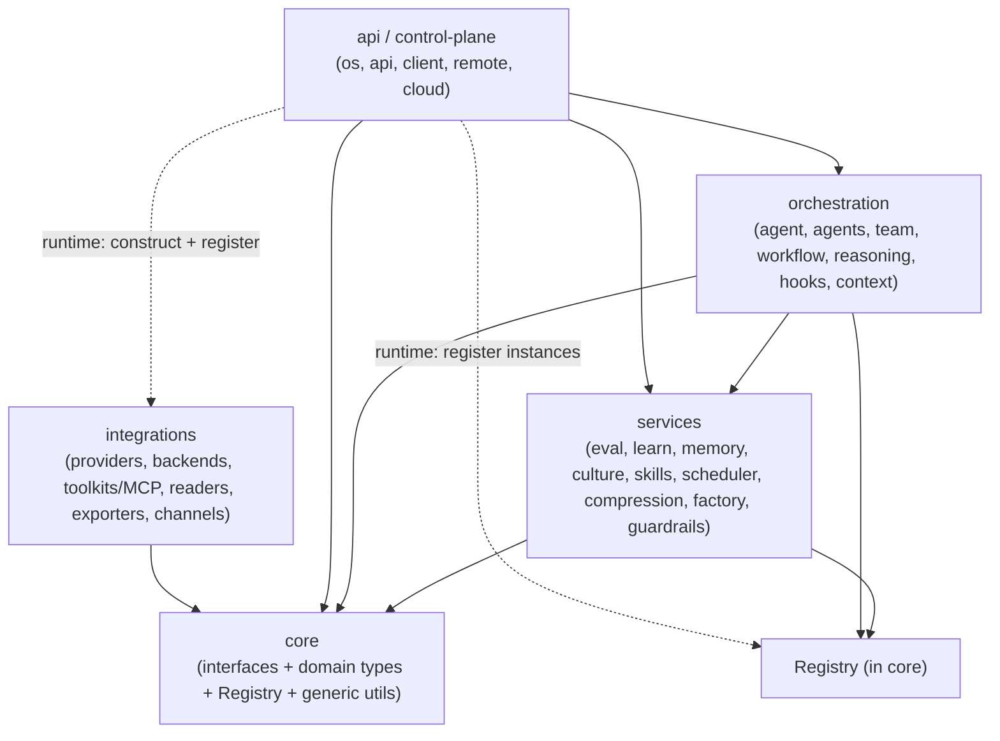

# ADR 0001: Layered Architecture and Dependency Rules

- **Status:** Proposed
- **Date:** 2026-07-22
- **Backlog:** EGPT-1.1 ([aicoe-tracker#42](https://github.com/Saturam-Inc/aicoe-tracker/issues/42))
- **Epic:** 1 – Modular architecture
- **Deciders:** Architecture owners (framework)

## Context

The framework package (`egpt`) mixes external-system code (concrete model providers, DB/vector backends, tools, knowledge readers, tracing exporters) into the same packages as domain interfaces. Core orchestration imports concrete integration modules directly. That coupling blocks reuse and independent evolution of adapters.

Before moving code (EGPT-1.4 through 1.8) or enforcing boundaries in CI (EGPT-1.11), we need an agreed target architecture and a one-directional dependency rule.

### Current inventory (top-level under `libs/agno/egpt/`)

Packages: `agent/`, `agents/`, `api/`, `approval/`, `client/`, `cloud/`, `compression/`, `context/`, `culture/`, `db/`, `eval/`, `factory/`, `guardrails/`, `hooks/`, `integrations/`, `knowledge/`, `learn/`, `memory/`, `models/`, `os/`, `reasoning/`, `registry/`, `remote/`, `run/`, `scheduler/`, `session/`, `skills/`, `team/`, `tools/`, `tracing/`, `utils/`, `vectordb/`, `workflow/`.

Loose modules: `brand.py`, `debug.py`, `exceptions.py`, `filters.py`, `media.py`, `metrics.py`.

Relevant existing seams:

- `integrations/` exists but is nearly empty (currently `discord/` only). It is repurposed as **the** integrations layer.
- `registry/registry.py` `Registry` already resolves models, tools, dbs, vector dbs, knowledge, and schemas by id/name. Keep and generalize later (EGPT-1.9); do not replace.

## Decision

Adopt a five-layer architecture with dependencies pointing **inward** toward stable core interfaces. Integrations are a separate, self-contained, reusable layer. Runtime resolution of concrete adapters goes through `Registry` (and, later, the DI container from EGPT-1.2).

### Layers and responsibilities

| Layer | Responsibility |
|-------|----------------|
| **core** | Stable interfaces, domain types, generic shared utilities, and the `Registry` resolution seam. No concrete external-system adapters; no static imports of integration modules. |
| **orchestration** | Agent / team / workflow runtime: planning, hooks, reasoning, and run context wiring. Depends on core interfaces only (plus services). |
| **services** | Supporting capabilities used by orchestration (eval, learn, memory, culture, skills, scheduler, compression, factory, guardrails). Depends on core interfaces only. |
| **integrations** | Concrete external-system adapters: model providers, DB/vector backends, toolkits/MCP, knowledge readers/embedders, tracing exporters, provider utils, and channel integrations. Depends on **core only**. Independently reusable and testable. |
| **api / control-plane** | HTTP/OS surfaces and remote clients (`os/`, `api/`, `client/`, `remote/`, `cloud/`). May depend on orchestration, services, and core. Must not import concrete integrations for business logic; the **composition root** (app startup) may construct integration objects and register them on `Registry`. |

### Layer diagram

Solid edges are **allowed static imports**. Dashed edges are **runtime registration only** (no static import from core → integrations).



**Registry semantics (normative):** `Registry` lives in core and only type-hints / stores objects against **core interfaces** (`Model`, `BaseDb`, `VectorDb`, `Function`, …). It must **never** statically import integration modules. A composition root (typically `egpt.os` / app startup, cookbooks, or tests) imports concrete integrations, constructs instances, and calls `Registry.add_*`. Upper layers then `get_*` by id/name. The dashed edges above are that runtime association—not a layer-import arrow.

Known debt for EGPT-1.9: `registry.py` currently TYPE_CHECKING-imports `Agent` / `Team` (orchestration). Those references must move behind protocols or out of core so the matrix remains enforceable.

### Design decisions

| # | Decision | Rationale | Alternatives considered |
|---|----------|-----------|-------------------------|
| 1 | Integrations are a separate, reusable layer | Isolate external systems for reuse and testability | Keep them mixed into core (rejected: current coupling) |
| 2 | Dependencies point inward to core interfaces | Stable core, swappable edges, no cycles | Bidirectional deps (rejected: cycles, fragility) |
| 3 | Repurpose the existing `integrations/` package | Already exists (near-empty); avoids a redundant top-level | New top-level directory (rejected: redundant) |
| 4 | Keep the existing `Registry` as the resolution seam | Already resolves by id/name; generalize rather than replace | Build a new registry (rejected: duplication) |
| 5 | Split interface from implementation in `models/`, `db/`, `vectordb/`, `knowledge/`, `tools/`, `utils/`, `tracing/` | Concrete mechanism that decouples core from integrations | Move whole packages wholesale (rejected: drags interfaces out of core) |

## Layer → module mapping

Logical target mapping for every current top-level module. Physical moves are implemented in EGPT-1.4 through 1.8; this table is the contract those tickets execute against.

Packages marked **split** keep interfaces/types in **core** and move concrete implementations to **integrations** (or, for some utils, to orchestration/services—see below).

### core (interfaces + domain)

| Module | Notes |
|--------|-------|
| `models/base.py`, `models/message.py`, `models/response.py`, `models/metrics.py`, `models/defaults.py`, `models/fallback.py` | Model interface and domain types stay in core. **Not** `models/utils.py` (see split table). |
| `db/base.py`, `db/schemas/`, `db/migrations/`, `db/table_names.py`, `db/filter_converter.py`, `db/utils.py` | DB interface + shared schema/migration helpers |
| `vectordb/base.py`, `vectordb/distance.py`, `vectordb/score.py`, `vectordb/search.py` | Vector DB interface + shared search helpers |
| `knowledge/protocol.py`, `knowledge/types.py`, `knowledge/content.py`, `knowledge/document/`, `knowledge/chunking/`, `knowledge/utils.py`, `knowledge/filesystem.py` | Knowledge interfaces and domain types (not readers/embedders). **`knowledge/knowledge.py` target stays core only after the prerequisite refactor below.** |
| `tools/function.py`, `tools/toolkit.py`, `tools/decorator.py` | Tool/function interfaces and registration decorator |
| `run/` | Run context and run-lifecycle domain types |
| `session/` | Session domain types |
| `approval/` | Approval domain types and `@approval` decorator |
| `registry/` | Resolution seam (`Registry`); generalized in EGPT-1.9 |
| `utils/` (generic only) | Shared helpers with no provider SDKs and no upward layer imports—see split table |
| `tracing/schemas.py`, `tracing/setup.py` | Tracing schemas / setup against core interfaces |
| `exceptions.py`, `filters.py`, `media.py`, `metrics.py`, `brand.py`, `debug.py` | Framework-wide domain / helper modules |

### orchestration

| Module | Notes |
|--------|-------|
| `agent/` | Primary agent runtime |
| `agents/` | Built-in / specialized agent definitions that are orchestration, not external adapters |
| `team/` | Multi-agent team runtime |
| `workflow/` | Workflow runtime |
| `reasoning/` | Reasoning loops / strategies |
| `hooks/` | Run hooks |
| `context/` (orchestration subset) | Context builders / assemblers (`backend.py`, `provider.py`, `mode.py`, `workspace/`, `fs/`, `wiki/`, …) |
| `utils/agent.py`, `utils/team.py`, `utils/events.py`, `utils/reasoning.py`, `utils/response.py`, `utils/hooks.py` | Helpers that import orchestration and/or services; cannot live in core |

### services

| Module | Notes |
|--------|-------|
| `eval/` | Evaluation |
| `learn/` | Learning stores / managers |
| `memory/` | Memory managers / strategies |
| `culture/` | Culture / shared preferences |
| `skills/` | Skills loading / management |
| `scheduler/` | Scheduling |
| `compression/` | Context compression |
| `factory/` | Component factories (construct via Registry / DI; no concrete provider imports) |
| `guardrails/` | Guardrail policies |

### integrations (separate, reusable)

| Module | Notes |
|--------|-------|
| `integrations/` | Existing package; destination for channel and other external adapters (already has `discord/`) |
| `models/<providers>/` | All concrete providers (`openai/`, `anthropic/`, `ollama/`, …) |
| `models/utils.py` | Provider construction table (`_PROVIDERS` → concrete module paths). **Must not stay in core.** |
| `db/<backends>/` | Concrete DB backends (`postgres/`, `sqlite/`, `mongo/`, …) |
| `vectordb/<backends>/` | Concrete vector backends (`pgvector/`, `lancedb/`, `chroma/`, …) |
| `tools/<toolkits>/`, `tools/mcp/`, `tools/mcp_toolbox.py` | Concrete toolkits and MCP adapters (not `function`/`toolkit`/`decorator`) |
| `knowledge/reader/`, `knowledge/embedder/`, `knowledge/reranker/`, `knowledge/loaders/`, `knowledge/remote_content/`, `knowledge/remote_knowledge.py` | I/O and remote knowledge adapters |
| `tracing/exporter.py` (+ provider-specific exporters when added) | Tracing exporters |
| `utils/gemini.py`, `utils/openai.py`, `utils/mcp.py`, `utils/streamlit.py`, `utils/models/` | Provider-/SDK-specific helpers |
| External connectors currently under `context/` (e.g. `gmail/`, `slack/`, `gdrive/`, `calendar/`, `google/`, `web/`, `database/`, `mcp/`) | Move into integrations when extracted |

### api / control-plane

| Module | Notes |
|--------|-------|
| `os/` | EgptOS app, routers, middleware — primary **composition root** for registering integrations on `Registry` |
| `api/` | API schemas / surfaces |
| `client/` | Client SDK |
| `remote/` | Remote agent/team clients |
| `cloud/` | Cloud deployment helpers |

### Split packages (interface vs implementation)

These packages are the central decoupling mechanism. Interfaces stay addressable from core; implementations live under the integrations layer (physically under `integrations/` or remaining as leaf packages that integrations owns for import-lint purposes—see EGPT-1.4–1.8).

| Package | Stay in core (interface / domain) | Move out of core |
|---------|-----------------------------------|------------------|
| `models/` | `base.py`, `message.py`, `response.py`, `metrics.py`, `defaults.py`, `fallback.py` | **Integrations:** every provider package (`openai/`, `anthropic/`, `google/`, …) **and** `utils.py` (provider construction / lazy import table) |
| `db/` | `base.py`, `schemas/`, `migrations/`, `table_names.py`, `filter_converter.py`, `utils.py` | **Integrations:** every backend package (`postgres/`, `sqlite/`, `mongo/`, …) |
| `vectordb/` | `base.py`, `distance.py`, `score.py`, `search.py` | **Integrations:** every backend package (`pgvector/`, `lancedb/`, `chroma/`, …) |
| `knowledge/` | `protocol.py`, `types.py`, `content.py`, `document/`, `chunking/`, `utils.py`, `filesystem.py`; **`knowledge.py` only after prerequisite refactor** | **Integrations:** `reader/`, `embedder/`, `reranker/`, `loaders/`, `remote_content/`, `remote_knowledge.py` |
| `tools/` | `function.py`, `toolkit.py`, `decorator.py` | **Integrations:** all toolkit modules, `mcp/`, `mcp_toolbox.py`, and similar adapters |
| `tracing/` | `schemas.py`, `setup.py` | **Integrations:** `exporter.py` and concrete exporters |
| `utils/` | Generic helpers only (e.g. `log.py`, `http.py`, `env.py`, `dttm.py`, `string` helpers, `media.py`, `json_schema.py`, `encryption.py`, …) | **Integrations:** `gemini.py`, `openai.py`, `mcp.py`, `streamlit.py`, `models/`. **Orchestration:** `agent.py`, `team.py`, `events.py`, `reasoning.py`, `response.py`, `hooks.py` |
| `context/` | — (no core slice) | **Orchestration:** builders/assemblers. **Integrations:** external connectors (`gmail/`, `slack/`, `gdrive/`, …) |

### Extraction prerequisites (must land with or before the corresponding move tickets)

1. **`knowledge/knowledge.py`:** Today this facade statically imports `knowledge.reader`, `remote_content`, and `remote_knowledge`. It cannot move into enforceable core until those dependencies are inverted (accept reader/remote ports via constructor / protocol, or split a thin core facade from an integrations composer). Until then, treat `knowledge.py` as **temporarily coupled** and out of the import-lint core set.
2. **`models/utils.py`:** Provider table must move with integrations (or become a registration API fed by integration entrypoints). Core must not retain the `_PROVIDERS` module-path map.
3. **Provider utils** (`utils/gemini.py`, `utils/openai.py`, `utils/models/`, …): move with their providers so core does not pull optional SDKs (`google-genai`, etc.).
4. **`Registry` ↔ `Agent`/`Team`:** replace orchestration TYPE_CHECKING imports with protocols or relocate agent/team catalogs out of core (EGPT-1.9).

### Traceability checklist (no orphans)

Every current **top-level** name under `libs/agno/egpt/` is assigned a primary layer below. Split packages also appear in the split table with sub-module destinations; that is intentional and does **not** mean the top-level name is unassigned.

| Top-level | Primary layer |
|-----------|---------------|
| `agent`, `agents`, `team`, `workflow`, `reasoning`, `hooks`, `context` | orchestration (context connectors → integrations when extracted) |
| `eval`, `learn`, `memory`, `culture`, `skills`, `scheduler`, `compression`, `factory`, `guardrails` | services |
| `integrations`, plus concrete slices of `models`, `db`, `vectordb`, `tools`, `knowledge`, `tracing`, `utils` | integrations |
| `os`, `api`, `client`, `remote`, `cloud` | api / control-plane |
| `run`, `session`, `approval`, `registry`, `exceptions.py`, `filters.py`, `media.py`, `metrics.py`, `brand.py`, `debug.py`, plus interface slices of split packages | core |

Covered names: `agent`, `agents`, `api`, `approval`, `brand.py`, `client`, `cloud`, `compression`, `context`, `culture`, `db`, `debug.py`, `eval`, `exceptions.py`, `factory`, `filters.py`, `guardrails`, `hooks`, `integrations`, `knowledge`, `learn`, `media.py`, `memory`, `metrics.py`, `models`, `os`, `reasoning`, `registry`, `remote`, `run`, `scheduler`, `session`, `skills`, `team`, `tools`, `tracing`, `utils`, `vectordb`, `workflow`.

## Allowed-import matrix

**The matrix below is normative.** EGPT-1.11 must encode it (path globs may change after physical moves, but allowed/forbidden cells must not). The import-linter sketch is illustrative of how to encode the matrix—not a second source of truth.

Rows are importers; columns are import targets. `Y` = allowed static import, `N` = forbidden.

| Importer ↓ / Target → | core | orchestration | services | integrations | api |
|-----------------------|------|---------------|----------|--------------|-----|
| **core** | Y (internal) | N | N | N | N |
| **orchestration** | Y | Y (internal) | Y | N | N |
| **services** | Y | N | Y (internal) | N | N |
| **integrations** | Y | N | N | Y (internal) | N |
| **api** | Y | Y | Y | N\* | Y (internal) |

\* **Exception (composition root only):** `api` / app-startup modules may import concrete integrations **solely** to construct instances and register them on `Registry`. All other api code follows `N`. EGPT-1.11 should confine this exception to an allowlisted set of modules (e.g. `egpt.os.app`, explicit `register_*` helpers)—not the whole api layer.

### Rules (normative)

1. **Matrix is authoritative.** The shorthand `api → orchestration → services → core` describes the primary inward path. **Shortcuts allowed by the matrix are intentional:** `api → services` and `api → core` are permitted; `orchestration → services` is permitted. Do not invent a stricter chain than the matrix.
2. **integrations → core only.** Integrations must not import orchestration, services, or api.
3. **orchestration and services** may depend on **core interfaces only**, never on concrete integration modules (no `from egpt.models.openai …`, `from egpt.db.postgres …`, toolkit modules, readers, exporters, `models.utils`, provider utils, etc.).
4. **api / control-plane** must not import concrete integrations outside the composition-root allowlist; obtain adapters via constructor injection / `Registry.get_*`.
5. **`Registry` (core)** is the runtime resolution seam. Upper layers resolve implementations by id/name through Registry (or the future DI container), not via static imports of integration modules. Core Registry code never imports integrations.
6. **Same-layer imports** are allowed.
7. **Cycles across layers are forbidden.**

### Import-linter encoding (for EGPT-1.11)

Encode the **matrix cells**, not an incomplete subset. After physical splits, map each layer to its modules; until then, contracts may use temporary path lists. Required contract shapes:

```ini
[importlinter]
root_package = egpt

# 1) Layers contract: api > orchestration > services > core
#    (import-linter "layers" type). Integrations are NOT in this stack;
#    they are constrained by the forbidden contracts below.
[importlinter:contract:layers]
name = Inward layers api > orchestration > services > core
type = layers
layers =
    egpt.os | egpt.api | egpt.client | egpt.remote | egpt.cloud
    egpt.agent | egpt.agents | egpt.team | egpt.workflow | egpt.reasoning | egpt.hooks | egpt.context
    egpt.eval | egpt.learn | egpt.memory | egpt.culture | egpt.skills | egpt.scheduler | egpt.compression | egpt.factory | egpt.guardrails
    egpt.registry | egpt.run | egpt.session | egpt.approval | egpt.models.base | egpt.models.message | egpt.models.response | egpt.db.base | egpt.vectordb.base | egpt.tools.function | egpt.tools.toolkit | egpt.tools.decorator | egpt.knowledge.protocol | egpt.knowledge.types | egpt.exceptions | egpt.filters | egpt.media | egpt.metrics | egpt.brand | egpt.debug
# Note: do not place egpt.knowledge.knowledge here until prerequisite #1 is done.
# Generic egpt.utils.* modules are added to the core layer after the utils split.

# 2) Upper layers must not import integrations (matrix N cells).
[importlinter:contract:no-integrations-from-upper]
name = core/orchestration/services must not import integrations
type = forbidden
source_modules =
    egpt.agent
    egpt.agents
    egpt.team
    egpt.workflow
    egpt.reasoning
    egpt.hooks
    egpt.context
    egpt.eval
    egpt.learn
    egpt.memory
    egpt.culture
    egpt.skills
    egpt.scheduler
    egpt.compression
    egpt.factory
    egpt.guardrails
    egpt.registry
    egpt.run
    egpt.session
    egpt.approval
    # plus core interface modules / generic utils after moves
forbidden_modules =
    egpt.integrations
    egpt.models.openai
    egpt.models.anthropic
    # …every concrete provider/backend/toolkit/reader/exporter module…
    egpt.models.utils
    egpt.utils.gemini
    egpt.utils.openai
    egpt.utils.mcp
    egpt.utils.streamlit
    egpt.utils.models
    egpt.knowledge.reader
    egpt.knowledge.embedder
    egpt.knowledge.reranker
    egpt.knowledge.loaders
    egpt.knowledge.remote_content
    egpt.knowledge.remote_knowledge
    egpt.tracing.exporter
    egpt.tools.mcp
    # …plus remaining toolkit modules after inventory in EGPT-1.11…

# 3) Integrations must not import orchestration, services, or api.
[importlinter:contract:integrations-depend-only-on-core]
name = Integrations depend only on core
type = forbidden
source_modules =
    egpt.integrations
    # plus concrete provider/backend/toolkit modules after moves
forbidden_modules =
    egpt.agent
    egpt.agents
    egpt.team
    egpt.workflow
    egpt.reasoning
    egpt.hooks
    egpt.context
    egpt.eval
    egpt.learn
    egpt.memory
    egpt.culture
    egpt.skills
    egpt.scheduler
    egpt.compression
    egpt.factory
    egpt.guardrails
    egpt.os
    egpt.api
    egpt.client
    egpt.remote
    egpt.cloud

# 4) Composition-root exception: allowlisted api modules may import integrations.
#    Implement via ignore_imports / separate contract exclusion list in EGPT-1.11.
```

EGPT-1.11 must expand the `…` placeholders to the full post-move module inventory and keep the matrix cells unchanged.

## Consequences

### Positive

- Clear ownership boundaries and a reusable integrations surface.
- Swappable providers/backends without rewriting orchestration.
- A single normative allowed-import matrix for reviewers and for CI enforcement.
- Existing `integrations/` and `Registry` are reused rather than reinvented.
- Registry→integrations coupling is defined as runtime registration only, so the matrix stays acyclic.

### Negative / follow-on work

- Requires coordinated package moves (EGPT-1.4–1.8) and temporary shims/re-exports during migration.
- Import paths for concrete providers will change for application code that currently imports them from `egpt.models.<provider>` etc. (migration notes belong in those tickets).
- `context/` and `utils/` are mixed packages; extraction must follow the split table.
- `knowledge/knowledge.py`, `models/utils.py`, provider utils, and Registry↔Agent/Team typing are explicit prerequisites (see above).
- Private `docs/` symlink workflow: this repo tracks only `docs/adr/` (see `.gitignore`). Prefer not to replace `docs/` with a full external symlink that would shadow the tracked ADR tree; keep private docs elsewhere or nest them beside `adr/`.

### Out of scope for this ADR

- Actually moving any code (EGPT-1.4 through 1.8).
- DI container (EGPT-1.2).
- Registry generalization (EGPT-1.9).
- CI import-linter enforcement (EGPT-1.11).

## Compliance / review gate

This ADR is approved when architecture owners confirm:

- [ ] Five layers defined with the layer diagram above (including Registry runtime-registration semantics)
- [ ] Layer → module mapping ratified (every current top-level module covered; split packages documented)
- [ ] Allowed-import matrix ratified as the **normative** input for EGPT-1.11 (sketch encodes all matrix N/Y cells, including upper↛integrations and integrations↛upper)
- [ ] Integrations designated a separate, self-contained, reusable layer
- [ ] Interface/implementation split documented for `models/` (including `models/utils.py`), `db/`, `vectordb/`, `knowledge/` (including `knowledge.py` prerequisite), `tools/`, `tracing/`, and `utils/`

## References

- Tracker: [EGPT-1.1 / aicoe-tracker#42](https://github.com/Saturam-Inc/aicoe-tracker/issues/42)
- Depends on: EGPT-0.10 (green baseline)
- Follow-ons: EGPT-1.2 (DI), EGPT-1.4–1.8 (extract moves), EGPT-1.9 (registry generalization), EGPT-1.11 (import-linter CI)
