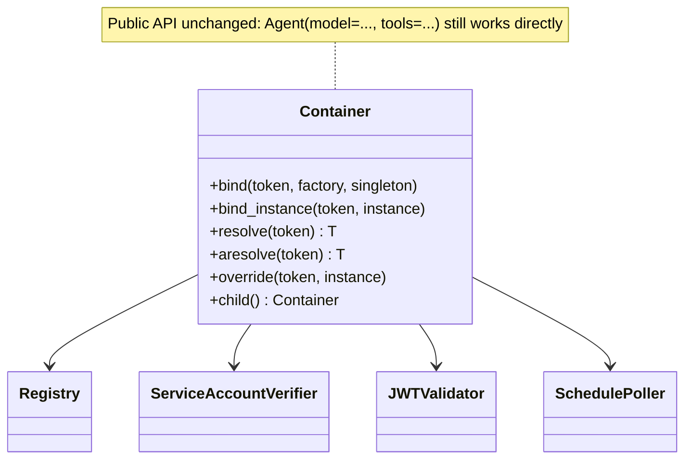

# ADR 0002: Dependency Injection for Internal Services

- **Status:** Proposed
- **Date:** 2026-07-28
- **Backlog:** EGPT-1.2 ([aicoe-tracker#43](https://github.com/Saturam-Inc/aicoe-tracker/issues/43))
- **Epic:** 1 – Modular architecture
- **Deciders:** Architecture owners (framework)

## Context

The framework already practises constructor injection at the object level: a caller writes
`Agent(model=..., tools=..., db=...)` and the agent stores what it is given (`agent/agent.py`). That is a strength of
the public API and is not in question here.

What is missing is a **composition root**. The control plane builds its collaborators by direct instantiation inside
`egpt/os/app.py`:

| Site | Service |
|------|---------|
| `scheduler_lifespan` | `ScheduleExecutor`, `SchedulePoller` |
| `_populate_registry*` (×4) | `Registry` |
| `_get_service_account_verifier` | `ServiceAccountVerifier` |
| `_add_auth_middleware` | `JWTValidator` |

Because construction is inline, an implementation can only be substituted by monkeypatching the module under test.
That makes the service graph rigid and the control plane awkward to test.

ADR 0001 (EGPT-1.1) already designates `egpt.os` the composition root and `Registry` the runtime resolution/construction
seam for components named in config. It explicitly defers the DI container to this ticket.

## Decision

Adopt a **small custom container** (`egpt/container.py`) as the composition root for **internal** services and
integration bindings. The public API is unchanged and the container is never required to use the framework.

### 1. Custom container, no new dependency

Options evaluated:

| Option | Assessment |
|--------|------------|
| `dependency-injector` | Most featureful and fastest, but ships C extensions (build/wheel burden across the 3.9–3.13 support matrix) and a declarative DSL that is far more machinery than this service graph needs. |
| `punq` / `lagom` | Pure Python and small, but each adds a runtime dependency to a framework core whose dependency list is deliberately minimal, and both lean on constructor type-hint autowiring — which does not fit services whose arguments come from `EgptOS` configuration rather than from types. |
| **Custom `Container` (chosen)** | ~250 lines, zero new dependencies, explicit factories, typed `resolve()` via `@overload`, and a first-class override seam for tests. |

`libs/agno/pyproject.toml` is therefore unchanged: no DI library is added.

### 2. Internal wiring only

The container binds services the framework itself constructs — control-plane services, integration implementations
(providers, stores, verifiers, schedulers). It is **not** how users assemble agents. `Agent(model=..., tools=..., db=...)`
stays exactly as it is, and nothing in `agent/`, `team/`, or `workflow/` resolves from a container.

### 3. Registry is bound, not replaced

`Registry` resolves components **by name/id** (models, tools, dbs, vector dbs, knowledge) and, per ADR 0001, will gain
constructor registration in EGPT-1.9. The container resolves **services by token**. These are different questions, so
the container binds `Registry` and defers to it; it does not grow a parallel name-based resolver.

### 4. Two token styles, by import safety

- **Type tokens** (`Registry`, `ServiceAccountVerifier`, `JWTValidator`) where the defining module is import-safe for
  anyone who installed `egpt[os]`. These keep `resolve()` typed.
- **String tokens** (`SCHEDULE_EXECUTOR`, `SCHEDULE_POLLER`) for services behind an optional extra
  (`egpt[scheduler]` pulls croniter/pytz), so importing the composition root never imports those packages.

### Design decisions

| # | Decision | Rationale | Alternatives considered |
|---|----------|-----------|-------------------------|
| 1 | Container for internal wiring only | Decouple and test services without burdening end users | Route all construction through DI (rejected: harms the ergonomic `Agent` API) |
| 2 | Keep public constructor injection | Users expect `Agent(model=...)`; it is a strength of the framework | Container-only construction (rejected: worse DX) |
| 3 | Bind `Registry`, do not duplicate it | One by-name resolution mechanism, per ADR 0001 | A parallel resolver in the container (rejected: duplication) |
| 4 | Custom minimal container | No new dependency; the graph is small and config-driven, not type-autowired | `dependency-injector` (C extensions), `punq` / `lagom` (dependency + autowiring mismatch) |
| 5 | Composition root in `egpt/os/container.py`, primitive in `egpt/container.py` | ADR 0001 puts the composition root in the api layer; core must not import api/integrations | Bindings in `egpt/container.py` (rejected: core would import control-plane services) |

## Architecture

Layer placement (ADR 0001):

- `egpt/container.py` — **core**. The primitive only; imports nothing but `egpt.exceptions`.
- `egpt/os/container.py` — **api / composition root**. Knows concrete services; the only place allowed to.

## Scope landed in EGPT-1.2

- `Container` with sync and async resolution, singleton/transient bindings, cycle detection, child scopes, and
  `override` / `override_factory` test seams.
- `build_os_container(agent_os, container=None)` binding `Registry`, `ServiceAccountVerifier`, `JWTValidator`, the JWT
  middleware kwargs, and the scheduler executor/poller.
- `EgptOS(container=...)` — an optional container whose existing bindings win over the defaults.
- `os/app.py` resolves the scheduler, auth verifier, JWT validator, and `Registry` from the container.

## Consequences

### Positive

- Internal services are substitutable in tests without patching production modules.
- One documented place where the control-plane graph is assembled.
- No new dependency, no change to the public API, no change to the import matrix in ADR 0001.

### Negative / follow-on work

- A hand-written container means we own its behaviour (thread/task safety, cycle detection) rather than a library.
- Most of `os/app.py` still constructs collaborators inline; migration is incremental and deliberately out of scope.
- Provider/plugin discovery and `Registry` constructor registration remain EGPT-1.9.

### Out of scope

- Migrating all of `os/app.py` to DI.
- Provider/plugin discovery (EGPT-1.9).
- Request-scoped containers (`Container.child()` exists, but nothing wires per-request scopes yet).

## References

- Tracker: [EGPT-1.2 / aicoe-tracker#43](https://github.com/Saturam-Inc/aicoe-tracker/issues/43)
- Depends on: EGPT-1.1 ([ADR 0001](0001-layered-architecture.md))
- Contributor guide: [`docs/di.md`](../di.md)
